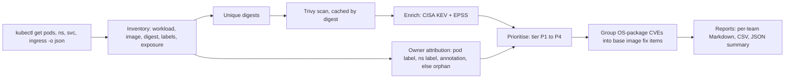

# Container Vulnerability Attribution Pipeline

Image scanners produce thousands of findings, and most of them never get fixed. Two reasons dominate: a finding with no owner reaches nobody, and the same base image CVE shows up once per application, so ten teams each get a ticket for a problem only a rebuild of one base image can fix. This project inventories running Kubernetes workloads, scans each unique image digest once with Trivy, attributes every finding to an owning team from namespace and pod metadata (flagging the rest as orphans), ranks findings on CISA KEV, EPSS, fix availability and exposure, and collapses base image CVEs into one fix item each. Shift-left controls sit alongside: Kyverno admission policies and a GitHub Actions gate on fixable critical CVEs with SARIF upload.

## Architecture



Shift-left runs separately:

- **Admission:** Kyverno policies (`policies/`) audit everywhere and enforce in the `secure` namespace.
- **CI:** `.github/workflows/image-scan.yaml` builds `sample-app/`, scans it with Trivy, uploads SARIF to the Security tab, and fails on fixable CRITICAL CVEs.

## Quickstart

Needs Docker, [kind](https://kind.sigs.k8s.io/), kubectl, helm, trivy and Python 3.11+ (versions in [Pinned versions](#pinned-versions)).

```bash
kind create cluster --name cva --config demo/kind-config.yaml
helm repo add kyverno https://kyverno.github.io/kyverno/
helm install kyverno kyverno/kyverno -n kyverno --create-namespace --version 3.9.1 --wait
kubectl apply -f policies/ -f demo/namespaces.yaml -f demo/workloads.yaml
kubectl apply -n secure -f demo/bad-pods/      # rejected three times, once per policy
python3 -m cva run --out reports/              # scans each unique digest
python3 -m cva run --out reports/              # second run: every digest from cache
```

`bash demo/run-demo.sh` does all of the above with readiness waits and assertions; the [`e2e-demo`](.github/workflows/e2e-demo.yaml) workflow runs it on a fresh kind cluster on every push and uploads the reports.

Flags: `--offline` (cached scans, KEV and EPSS only), `--rescan` (ignore the scan cache), `--include-system` (also scan `kube-system`, `kyverno`, `local-path-storage`), `--context`, `--cache-dir`, `--trivy`.

## What it produces

| File | Contents |
|---|---|
| `reports/summary.json` | counts by tier, team and orphan status; base image fix items; EOL images; scan cache stats |
| `reports/findings.csv` | one row per finding per workload: owner, owner_source, tier, KEV, EPSS, fix, exposure |
| `reports/teams/<team>.md` | per-team remediation list, P1 first, each row an exact upgrade action |
| `reports/ORPHANS.md` | workloads with no owner, and their findings |
| `reports/BASE_IMAGES.md` | grouped base image fix items and end-of-life base images |

### Demo workloads

| Workload | Image | Owner | What it proves |
|---|---|---|---|
| payments-api | `nginx:1.25.3` (Debian 12), NodePort Service | `team=payments` | exposed + KEV/EPSS + fixable → P1 |
| orders-worker | `python:3.12.13-slim-bookworm` (Debian 12) | `team=orders` | app-layer vs OS split; shares a base with payments-api |
| legacy-report | `node:14.21.3-buster-slim` (Debian 10, EOL) | none | orphan + end-of-life base image |
| clean-app | `gcr.io/distroless/static-debian12:debug-nonroot` | `team=platform` | near-zero baseline (3 findings, none above UNKNOWN) |

Every image is pinned by tag and digest. clean-app uses the `debug-nonroot` variant only because plain distroless has no binary to keep the container running; it has the same package set and findings as `:nonroot`.

### Sample `summary.json`

<!-- FILL from the e2e-demo artifact before publishing -->

### Top of `reports/teams/payments.md`

<!-- FILL from the e2e-demo artifact before publishing -->

## Admission control

Three `ClusterPolicy` resources, each with `failureAction: Audit` and a `failureActionOverrides` entry that enforces in `secure` (`kube-system` and `kyverno` excluded):

- `require-team-label`: pods must carry a non-empty `team` label.
- `disallow-latest-tag`: images must have an explicit tag and it must not be `:latest`.
- `require-non-root`: `runAsNonRoot: true` (pod or every container) and `allowPrivilegeEscalation: false`.

Each manifest in `demo/bad-pods/` violates exactly one policy. Output of `kubectl apply -n secure -f demo/bad-pods/`:

<!-- FILL from reports/admission.txt in the e2e-demo artifact -->

In `demo` the same policies only audit, so the vulnerable samples run and show up in `kubectl get policyreports -n demo`.

`secure` enforces Pod Security `baseline` and warns/audits on `restricted`. The built-in PodSecurity admission plugin runs before admission webhooks, so enforcing `restricted` there would reject the root pod before Kyverno sees it; Kyverno is the enforcement point being demonstrated.

## CI gate

`image-scan.yaml` runs on push and pull request with `permissions: contents: read, security-events: write` only. Trivy runs with `severity: CRITICAL`, `ignore-unfixed: true`, `exit-code: 1`, and `limit-severities-for-sarif: true` (without it, trivy-action drops the severity filter for SARIF output and the gate fires on any fixable finding). SARIF uploads with `if: always()` so results land in the Security tab even when the gate fails.

- Failing run (base `python:3.12.13-slim-bookworm`, fixable CRITICALs in `perl-base`): <!-- FILL run URL -->
- Passing run (base `python:3.12.14-slim-trixie`): <!-- FILL run URL -->

## Design decisions

- **Digest, not tag, is the dedupe and cache key.** Tags are mutable and two tags can point to one image; a digest is the content. Replicas and workloads sharing an image are scanned once, and `.cache/trivy/<digest>.json` is valid forever for that content (only the vulnerability DB moves; `--rescan` refreshes).
- **Labels for ownership.** Ownership lives next to the workload and travels with it through GitOps. Precedence is pod label `team` → namespace label `team` → pod annotation `owner` → ORPHAN, and every finding records which rule matched (`owner_source`), so attribution is auditable. Admission policy keeps new workloads from becoming orphans.
- **OS findings to base image owners, app findings to app teams.** `os-pkgs` findings come from the base layer; one rebuild fixes them for every app on that base, so they are grouped by (OS release, package, fixed version). Debian point releases (12.5, 12.15) share one archive, so grouping uses the major release. `lang-pkgs` findings are the app team's dependency upgrades and stay per image.
- **Tiers instead of a raw score.** Each tier is one sentence a responder can repeat and challenge (see `cva/scoring.py`). P1 requires exploit evidence (KEV, or EPSS ≥ 0.5), an available fix, and external exposure; unfixed findings are tracked as P4 rather than paged. Within a tier: KEV, then EPSS, severity, number of affected workloads, then exposure.
- **The CI gate blocks only fixable criticals.** Blocking on findings nobody can fix yet trains developers to bypass the gate; fixable criticals have a concrete action (bump the base or dependency).
- **Read-only, efficient.** Only `get`/`list` on pods, namespaces, services and ingresses. Deployments are recovered from ReplicaSet names via the `pod-template-hash` label, so no ReplicaSet read access is needed. KEV downloads at most daily; EPSS is queried 100 CVEs per request and cached.

## Pinned versions

Everything is pinned: GitHub Actions by full commit SHA, images by tag and digest, tools by version with SHA-256 checked in `e2e-demo.yaml`, test dependencies by hash (`requirements-dev.txt`). This matters because of the March 2026 Trivy supply chain compromise ([GHSA-69fq-xp46-6x23](https://github.com/aquasecurity/trivy/security/advisories/GHSA-69fq-xp46-6x23)), in which attackers force-pushed 76 of 77 `trivy-action` tags and all `setup-trivy` tags to malicious commits and published a malicious Trivy v0.69.4. Anyone referencing a tag ran attacker code; SHA pins were unaffected.

| Component | Version | Pin |
|---|---|---|
| Trivy | 0.75.0 (released after the compromise) | SHA-256 `c6e65abd…` |
| aquasecurity/trivy-action | v0.36.0 | `ed142fd0673e97e23eac54620cfb913e5ce36c25`; pins setup-trivy `3fb12ec` (v0.2.6, named safe in the advisory) |
| actions/checkout | v7.0.1 | `3d3c42e5aac5ba805825da76410c181273ba90b1` |
| github/codeql-action/upload-sarif | v4.38.3 | `24c54180a607b1449ed407dd24f251e4e9147c8d` |
| actions/setup-python | v7.0.0 | `5fda3b95a4ea91299a34e894583c3862153e4b97` |
| actions/upload-artifact | v7.0.1 | `043fb46d1a93c77aae656e7c1c64a875d1fc6a0a` |
| kind / node image | v0.33.0 / v1.36.4 | node image digest in `demo/kind-config.yaml` |
| kubectl / helm | v1.36.4 / v3.22.0 | SHA-256 in `e2e-demo.yaml` |
| Kyverno | chart 3.9.1 (app v1.19.1) | `--version 3.9.1` |
| pytest | 9.1.1 | hashes in `requirements-dev.txt` |

## Tests

```bash
python3 -m pip install --require-hashes -r requirements-dev.txt
python3 -m pytest -q
```

Tests run offline against fixtures in `tests/fixtures/`: kubectl JSON captured from the demo cluster, Trivy JSON for the four demo digests (real output with unused fields such as descriptions and CVSS vectors stripped), and KEV/EPSS snapshots trimmed to those CVEs. A socket guard fails any test that touches the network. `scripts/capture_fixtures.py` refreshes them from a live cluster.

- `test_attribution.py`: precedence order, blank values, orphan detection, Deployment resolution, exposure.
- `test_scoring.py`: every tier boundary (KEV, EPSS 0.1/0.5, fixed vs unfixed, exposure) and sort order.
- `test_grouping.py`: two images sharing Debian 12 collapse into one fix item; the EOL flag carries through.
- `test_pipeline.py`: each digest scanned once, second run fully cached, all five reports written.

## Limitations

- A local kind lab with four sample workloads, not a production fleet.
- Ownership is label-based only. Unlabelled workloads become orphans; there is no CODEOWNERS or CMDB lookup.
- Only images running in the cluster are scanned; no registry-wide scanning, no SBOM storage.
- KEV and EPSS are point-in-time snapshots; tiers change as the feeds do.
- No VEX, so findings in code paths that are never reached are still reported.
- Kyverno `kyverno.io/v1 ClusterPolicy` is deprecated as of 1.19 in favour of CEL-based `ValidatingPolicy`. It is used here because `failureActionOverrides` expresses "audit everywhere, enforce in `secure`" in one resource per policy.

## Production next steps

Registry scanning on push, SBOM generation and storage (so new CVEs are matched without rescanning), VEX statements for false positives, CODEOWNERS/CMDB as ownership sources with labels as the override, ticket creation per fix item, and the policies migrated to `ValidatingPolicy`.
